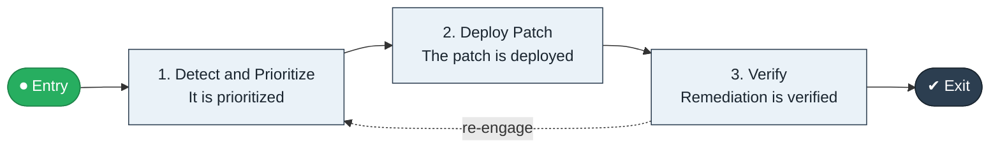

# Vulnerability to Patch

`value-streams:value-stream-vulnerability-to-patch-23tu27` · **governance** · technology · industry-specific

> The vulnerability stream from disclosure detection through prioritization to patched, verified systems.

**Outcome:** Patched, verified systems within policy windows.

**Machine-readable:** this page is generated from — and must stay in sync with — the authoritative record [`value-streams-value-stream-vulnerability-to-patch-23tu27.yaml`](./value-streams-value-stream-vulnerability-to-patch-23tu27.yaml). The front matter above is YAML-extractable metadata.

## Stage flow

## Value stages

| # | Stage | Entry criterion | Exit criterion | Enabling capabilities (count) | Realizing processes (count) | Visible |
|---|---|---|---|---|---|---|
| 1 | **Detect and Prioritize** | A vulnerability appears. | It is prioritized. | 2 | 1 | no |
| 2 | **Deploy Patch** | The vulnerability is prioritized. | The patch is deployed. | 2 | 1 | no |
| 3 | **Verify** | The patch is deployed. | Remediation is verified. | 2 | 1 | no |

### 1. Detect and Prioritize

Detect and prioritize the vulnerability.

| Aspect | Value |
|---|---|
| Entry criterion | A vulnerability appears. |
| Exit criterion | It is prioritized. |
| Outcome | A prioritized vulnerability. |
| Customer visible | False |
| Enabling capabilities | `capabilities:capability-security-management-wmzc7c` · `capabilities:capability-risk-management-h9uxdw` |
| Realizing processes | `processes:process-sd-operate-ucxpz4` |

### 2. Deploy Patch

Deploy the patch.

| Aspect | Value |
|---|---|
| Entry criterion | The vulnerability is prioritized. |
| Exit criterion | The patch is deployed. |
| Outcome | A deployed patch. |
| Customer visible | False |
| Enabling capabilities | `capabilities:capability-technology-enablement-y6nkws` · `capabilities:capability-operations-management-pm3w8k` |
| Realizing processes | `processes:process-eo-operate-xud3hs` |

### 3. Verify

Verify remediation.

| Aspect | Value |
|---|---|
| Entry criterion | The patch is deployed. |
| Exit criterion | Remediation is verified. |
| Outcome | Verified remediation. |
| Customer visible | False |
| Enabling capabilities | `capabilities:capability-security-management-wmzc7c` · `capabilities:capability-information-management-6vjgdh` |
| Realizing processes | `processes:process-eo-operate-44jsrp` |

## Scope boundary

**Entry:** A vulnerability is disclosed or detected.

**Exit:** The vulnerability is patched and verified.

**In scope**

- Detection and prioritization
- Patch deployment
- Verification

**Out of scope** (owned by the named neighbour)

- Change delivery (Commit to Deploy)
- Security operations (Security Alert to Remediation)

## Traceability

**Capabilities** (`aggregated_capability_refs`, resolving in [business-capabilities](https://github.com/technehub-labs/dea-catalog-business-capabilities)):

- `capabilities:capability-security-management-wmzc7c`
- `capabilities:capability-risk-management-h9uxdw`
- `capabilities:capability-technology-enablement-y6nkws`
- `capabilities:capability-operations-management-pm3w8k`
- `capabilities:capability-information-management-6vjgdh`

**Processes** (`process_refs`, resolving in [business-processes](https://github.com/technehub-labs/dea-catalog-business-processes)):

- `processes:process-sd-operate-ucxpz4`
- `processes:process-eo-operate-xud3hs`
- `processes:process-eo-operate-44jsrp`

## Cross-stream links

**Upstream:** none recorded.

**Downstream:** none recorded.

## Measurement

- **Patch SLA compliance** (stream-level) — Share of vulnerabilities patched within policy windows.

## Evidence

| Source | Class | Reference |
|---|---|---|
| SRC-019 | industry-reference-model | Technology / SaaS product chains (public structure) |

**Rationale:** Admitted under CR-VS-12 (population tranche; candidate VSC-112) from the CR-VS-11 industry evidence register extension. Industry-specific chain (technology); distinct from cross-industry streams by applicability (CR-VS-11 method note); cross-catalog references resolve against the sibling catalogs per the referential-integrity gate.

See [research/evidence.md](./research/evidence.md) for the source-backed notes.

## Provenance ladder

| Stage | Date | Actor |
|---|---|---|
| candidate | 2026-10-28 | Emmanuel A. Otchere, candidate universe v0.6 (CR-VS-12) |
| admitted | 2026-10-28 | Emmanuel A. Otchere, admission CR-VS-12 |

---

*Generated by [`scripts/generate_entity_docs.py`](../../../scripts/generate_entity_docs.py) (CR-VS-13) from the authoritative record. Do not edit by hand; regenerate.*
