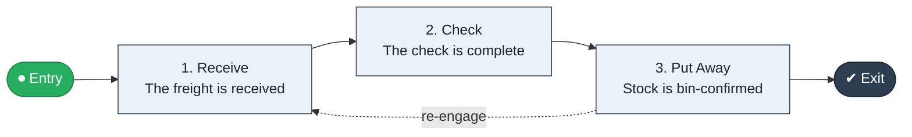

# Warehouse Inbound to Bin

`value-streams:value-stream-warehouse-inbound-to-bin-b67zvk` · **support** · logistics-transportation · industry-specific

> The warehousing stream from carrier arrival through receiving and putaway to bin-confirmed stock.

**Outcome:** Bin-confirmed, system-visible received stock.

**Machine-readable:** this page is generated from — and must stay in sync with — the authoritative record [`value-streams-value-stream-warehouse-inbound-to-bin-b67zvk.yaml`](./value-streams-value-stream-warehouse-inbound-to-bin-b67zvk.yaml). The front matter above is YAML-extractable metadata.

## Stage flow

## Value stages

| # | Stage | Entry criterion | Exit criterion | Enabling capabilities (count) | Realizing processes (count) | Visible |
|---|---|---|---|---|---|---|
| 1 | **Receive** | A carrier arrives. | The freight is received. | 1 | 1 | no |
| 2 | **Check** | The freight is received. | The check is complete. | 2 | 1 | no |
| 3 | **Put Away** | The check is complete. | Stock is bin-confirmed. | 1 | 1 | no |

### 1. Receive

Receive the inbound freight.

| Aspect | Value |
|---|---|
| Entry criterion | A carrier arrives. |
| Exit criterion | The freight is received. |
| Outcome | Received freight. |
| Customer visible | False |
| Enabling capabilities | `capabilities:capability-operations-management-pm3w8k` |
| Realizing processes | `processes:process-eo-operate-zwzmbd` |

### 2. Check

Check quantity and condition.

| Aspect | Value |
|---|---|
| Entry criterion | The freight is received. |
| Exit criterion | The check is complete. |
| Outcome | Checked stock. |
| Customer visible | False |
| Enabling capabilities | `capabilities:capability-risk-management-h9uxdw` · `capabilities:capability-information-management-6vjgdh` |
| Realizing processes | `processes:process-eo-operate-44jsrp` |

### 3. Put Away

Put away and confirm bin locations.

| Aspect | Value |
|---|---|
| Entry criterion | The check is complete. |
| Exit criterion | Stock is bin-confirmed. |
| Outcome | Bin-confirmed stock. |
| Customer visible | False |
| Enabling capabilities | `capabilities:capability-operations-management-pm3w8k` |
| Realizing processes | `processes:process-eo-operate-zwzmbd` |

## Scope boundary

**Entry:** A carrier arrives with inbound freight.

**Exit:** Stock is confirmed in its bin locations.

**In scope**

- Receiving
- Quality and quantity check
- Putaway and bin confirmation

**Out of scope** (owned by the named neighbour)

- Freight (Ship to Consignee)
- Order fulfilment pick (Checkout to Fulfillment)

## Traceability

**Capabilities** (`aggregated_capability_refs`, resolving in [business-capabilities](https://github.com/technehub-labs/dea-catalog-business-capabilities)):

- `capabilities:capability-operations-management-pm3w8k`
- `capabilities:capability-risk-management-h9uxdw`
- `capabilities:capability-information-management-6vjgdh`

**Processes** (`process_refs`, resolving in [business-processes](https://github.com/technehub-labs/dea-catalog-business-processes)):

- `processes:process-eo-operate-zwzmbd`
- `processes:process-eo-operate-44jsrp`

## Cross-stream links

**Upstream:** none recorded.

**Downstream:** none recorded.

## Measurement

- **Dock-to-stock time** (stream-level) — Elapsed hours from arrival to bin-confirmed stock.

## Evidence

| Source | Class | Reference |
|---|---|---|
| SRC-016 | industry-reference-model | Manufacturing and logistics reference models (SCOR-style category structure) |

**Rationale:** Admitted under CR-VS-12 (population tranche; candidate VSC-068) from the CR-VS-11 industry evidence register extension. Industry-specific chain (logistics-transportation); distinct from cross-industry streams by applicability (CR-VS-11 method note); cross-catalog references resolve against the sibling catalogs per the referential-integrity gate.

See [research/evidence.md](./research/evidence.md) for the source-backed notes.

## Provenance ladder

| Stage | Date | Actor |
|---|---|---|
| candidate | 2026-10-28 | Emmanuel A. Otchere, candidate universe v0.6 (CR-VS-12) |
| admitted | 2026-10-28 | Emmanuel A. Otchere, admission CR-VS-12 |

---

*Generated by [`scripts/generate_entity_docs.py`](../../../scripts/generate_entity_docs.py) (CR-VS-13) from the authoritative record. Do not edit by hand; regenerate.*
